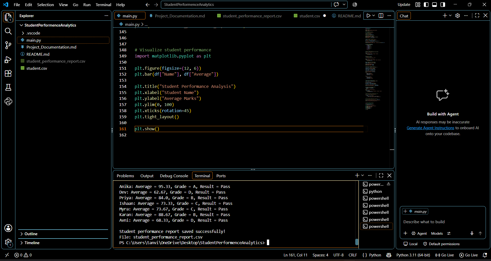

# Student Performance Analytics System

## 1. Project Title

**Student Performance Analytics System**

Course: Python with AI — EWB Courses

Student Name: Srushti Sitaram Temgire 

## 2. Objective

The objective of this project is to develop a Python-based system that analyzes student marks and attendance data. It calculates total and average marks, assigns grades, identifies pass/fail results, and finds top-performing students.

## 3. Technologies Used

- Python
- Pandas
- NumPy
- Matplotlib
- CSV files for storing student data

## 4. Dataset Description

The project uses a CSV dataset containing 20 sample student records.

The dataset includes the following columns:

- StudentID
- Name
- Department
- Maths
- Science
- English
- Attendance

The data is loaded and organized using a Pandas DataFrame.

## 5. Implementation

1. Read student records from a CSV file using Pandas.
2. Display the dataset and basic information.
3. Calculate each student's total and average marks.
4. Assign grades using a reusable function.
5. Determine pass/fail results using NumPy.
6. Calculate the class average and identify the highest and lowest performers.
7. Calculate subject-wise average marks.
8. Identify the top three students.
9. Use a loop to display individual student performance.
10. Export the analyzed results to a CSV report.
11. Visualize student averages using a bar chart.

## 6. Key Features

- Student dataset loading
- Total and average marks calculation
- Grade assignment
- Pass/fail analysis
- Class performance summary
- Subject-wise analysis
- Top three student ranking
- CSV report generation
- Student performance visualization
## 7. Output / Screenshots

### 7.1 Student Analysis Output

The terminal output displays the student records, total and average marks, grades, pass/fail results, class performance summary, subject-wise averages, and top three students.

### 7.2 Student Performance Bar Chart

The bar chart visualizes the average marks of the students and helps compare their academic performance.

### 7.3 Generated CSV Report

The program generates `student_performance_report.csv`, which contains the student data and calculated performance results.

## 8. Final Outcome

The project demonstrates how Python, Pandas, and NumPy can be used to analyze student performance data. It generates useful summaries, identifies top-performing students, and saves the analyzed data for future reference.

## 9. Challenges & Learning

This section should describe the actual challenges encountered while developing the project and how they were resolved.

Learning outcomes include working with CSV files, Pandas DataFrames, numerical calculations, functions, conditions, loops, and data visualization.

## 10. GitHub Repository

## 10. GitHub Repository

The complete source code, dataset, and project files are available in the following GitHub repository:

https://github.com/srushtitemgire2016/student-performance-analytics

